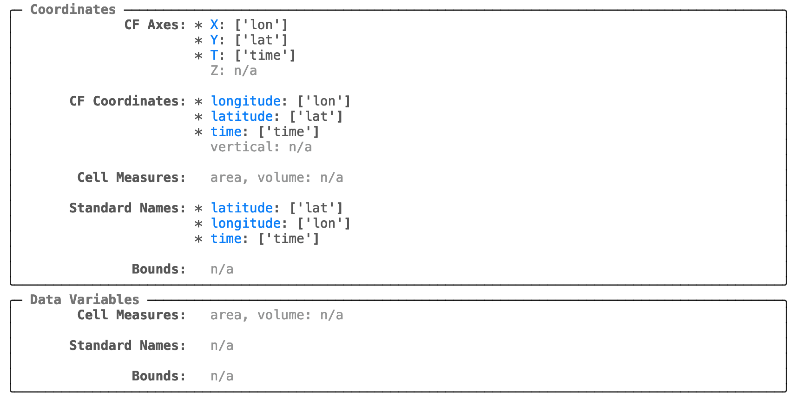

# Frequently Asked Questions

## Why does selecting a variable with `.cf` drop some coordinates?

Xarray and cf-xarray use different rules when selecting a DataArray from a
Dataset. Xarray attaches coordinates whose dimensions fit the selected variable.
cf-xarray uses CF metadata to identify associated variables, retaining dimension
coordinates but not automatically attaching every compatible auxiliary coordinate.
This matters on staggered grids, where several latitude and longitude variables
can have the same dimensions but describe different locations.

For example, a latitude coordinate can be available through ordinary xarray
selection but missing after selection by a standard name:

```python
import cf_xarray
import xarray as xr

ds = xr.Dataset(
    {
        "temp": (
            "station",
            [280.0, 281.0],
            {"standard_name": "air_temperature", "units": "K"},
        )
    },
    coords={
        "station": [0, 1],
        "lat": (
            "station",
            [50.0, 51.0],
            {"standard_name": "latitude", "units": "degrees_north"},
        ),
    },
)

"lat" in ds["temp"].coords  # True
"lat" in ds.cf["air_temperature"].coords  # False

ds["temp"].attrs["coordinates"] = "lat"
"lat" in ds.cf["air_temperature"].coords  # True
ds.cf["air_temperature"].cf["latitude"]  # now finds lat
```

The `coordinates` attribute contains space-separated **variable names**, not
standard names. It explicitly associates auxiliary coordinates with the data
variable. Only include coordinates that describe that variable; do not copy all
Dataset coordinates indiscriminately.

When xarray decodes a file, it may move `coordinates` from `.attrs` to `.encoding`.
cf-xarray reads either location. Inspect both before editing metadata, and update
the existing entry rather than leaving conflicting values in the two locations.
If an operation creates or removes an auxiliary coordinate, check that these
associations still describe the resulting data.

See [Selecting Variables](selecting.md) and the
[CF coordinate-system conventions](https://cfconventions.org/Data/cf-conventions/cf-conventions-1.12/cf-conventions.html#coordinate-system).

## I find `.cf` repr hard to read!

Install [rich](https://rich.readthedocs.io) and load the Jupyter extension for easier-to-read reprs.

```python
%load_ext rich

import cf_xarray
import xarray as xr

ds = xr.tutorial.open_dataset("air_temperature")
ds.cf
```


